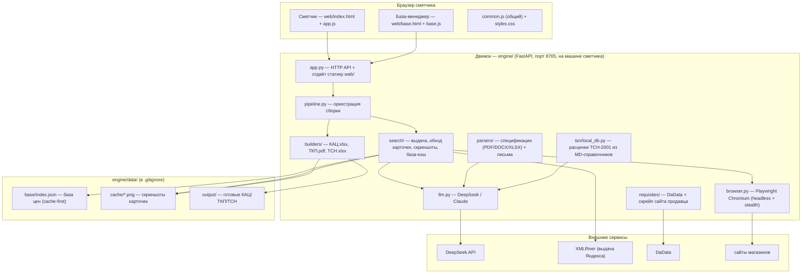

# Генрих / КАЦ-генератор — онбординг разработчика

> Документ для программиста, который принимает проект и продолжает разработку.
> Составлен 2026-09-07 по состоянию кода на коммите `92aeadb` (последняя работа — 17 июня 2026).
> Дополняет — не заменяет — [`HANDOFF.md`](HANDOFF.md) и [`STATUS.md`](STATUS.md).
> Разделы ниже описывают исходное состояние на 07.09.2026. Актуальные репозиторий,
> ветка и результат прогона спецификации указаны в [`HANDOFF.md`](HANDOFF.md).

---

## 0. TL;DR за минуту

- **Что это.** Локальное приложение для сметчика строительной компании ГРАФТИО. По спецификации
  оборудования (проектная документация) и письмам с ценами оно автоматически собирает три
  выходных документа в формате эталонного образца: **Том ТКП** (PDF), **КАЦ** (Excel),
  **файл ТСН-2001** (Excel).
- **Из чего состоит.** Один Python-движок (`engine/`, FastAPI + Playwright + LLM) + статический
  веб-интерфейс (`web/`, ванильный HTML/CSS/JS). Движок запускается на машине сметчика, потому что
  для обхода антибота магазинов и mos.ru нужен российский IP и настоящий браузер.
- **Два приложения на одной кодовой базе** под брендом «Генрих»: страница **Сметчик** (`/`) и
  страница **База-менеджер** (`/base.html`). Общий движок, общий код.
- **Язык, стек.** Python 3.11+, FastAPI, Playwright (Chromium), Pydantic v2, openpyxl, PyMuPDF.
  Фронт — без сборки и без фреймворка. LLM сейчас — **DeepSeek** (не Claude).
- **Репозиторий.** <https://github.com/Graftio-ru/kac-generator>. Текущая работа —
  в ветке `feat/kac-supplier-search-hardening`.
- **Что НЕ в репозитории и нужно получить отдельно:** файл секретов `engine/.env`, папка
  `Obrazcy/` с эталонными образцами, накопленная база цен (сейчас пустая).

---

## 1. Доступы и ссылки

| Что | Где | Примечание |
|---|---|---|
| Исходный код | <https://github.com/Graftio-ru/kac-generator> | текущая работа в `feat/kac-supplier-search-hardening` |
| Задеплоенный UI | <https://inslyer.github.io/kac-generator/> | GitHub Pages из папки `web/`; для **локальной** работы использовать `http://127.0.0.1:8765/` (см. §6) |
| Старый прототип (архив) | <https://github.com/Inslyer/smeta-app> | Streamlit-монолит, предшественник, заброшен 10.06.2026 — только для истории, **не трогать** |
| GitHub-аккаунт | `Graftio-ru` | организация владеет текущим репозиторием; `Inslyer/smeta-app` остаётся историческим прототипом |
| Локальная рабочая копия | `/Users/MmM/WebstormProjects/graftio/kac-generator` | ветка `feat/kac-supplier-search-hardening` |
| Память проекта (заметки) | `~/.claude/projects/-Users-yuriy-Documents-Claude-KA/memory/` | `kac-generator-project.md`, `kac-generator-backlog.md` — история решений и бэклог; продублировано в этом документе |

### Внешние сервисы (нужны ключи)

| Сервис | Зачем | Тариф | Личный кабинет |
|---|---|---|---|
| **DeepSeek API** | структуризация спецификаций, разбор писем, извлечение цены/ИНН со страниц, матчинг наименований, матчинг ТСН | платный, дёшево | <https://platform.deepseek.com/api_keys> |
| **Anthropic (Claude)** | тот же слой, если переключить `LLM_PROVIDER=anthropic`; альтернативный провайдер с vision | платный | <https://console.anthropic.com> |
| **DaData** | реквизиты (наименование/КПП/адрес) организации-продавца по ИНН | есть бесплатный тариф | <https://dadata.ru> |
| **XMLRiver** (SERP-API) | выдача Яндекса в XML без капчи (замена официальному Yandex Search API, который новым аккаунтам недоступен) | платный, по запросам | <https://xmlriver.com> (user_id в проекте — `21356`) |

---

## 2. ⚠️ Передача секретов (сделать в первую очередь)

Файл **`engine/.env`** содержит боевые ключи и **в git не коммитится** (`.gitignore`). Значит, при
клонировании репозитория программист их не получит. Нужно:

1. Передать содержимое `engine/.env` **по защищённому каналу** (не в почте, не в мессенджере
   открытым текстом, не в этом документе, не в issue). Ключи, которые там лежат:
   `ANTHROPIC_API_KEY`, `DEEPSEEK_API_KEY`, `DADATA_TOKEN`, `XMLRIVER_USER` + `XMLRIVER_KEY`.
2. **Рекомендуется перевыпустить (ротировать) все ключи** при передаче проекта другому человеку и
   отдать новые. Каждый ключ отзывается/пересоздаётся в личном кабинете соответствующего сервиса
   (ссылки в §1). После — вписать новые значения в `engine/.env` на машине разработчика.
3. Актуальный шаблон переменных — в §8 этого документа (файл `engine/.env.example` в репозитории
   **устарел**, см. §12).

Публичный репозиторий сам по себе секретов не содержит (проверено): `.env`, база цен и кэш
скриншотов — в `.gitignore`. В открытом виде в репозитории лежат только `Поставщики.md` (ИНН/КПП
29 юрлиц — публичные данные) и справочники ТСН.

---

## 3. Архитектура

### 3.1. Общая схема



### 3.2. Почему движок локальный, а не на сервере

Магазины и `mos.ru` блокируют серверные IP и зарубежный трафик (у владельца — зарубежный VPN
AmneziaVPN). Настоящий Chromium на машине с российским IP проходит там, где серверный `fetch`
получает капчу или таймаут. Поэтому «тяжёлая» часть — движок — работает у сметчика, а на GitHub
Pages лежит только статический UI, который к движку обращается по `http://127.0.0.1:8765`.

### 3.3. Два приложения — одна кодовая база

Обе страницы обслуживает один движок и один набор JS-модулей. Поведение страницы настраивается
объектом `window.POS` перед подключением `common.js`:

| Страница | Файлы | `window.POS` | Что делает |
|---|---|---|---|
| **Сметчик** | `web/index.html`, `web/app.js` | `{ showSearch:false, showTsn:false, baseBadge:true }` | Распознаёт спецификацию → тянет готовые блоки из базы (`POST /base/fill`, **без онлайн-поиска**) → помечает позиции «нет в базе» / «из базы» → собирает **Том ТКП + КАЦ**. Сборка идёт с `use_tsn=false`, `skip_search=true`. |
| **База-менеджер** | `web/base.html`, `web/base.js` | `{ showSearch:true, showTsn:false, baseBadge:false }` | **Импорт списка позиций из Excel** (`POST /base/import`, прямой `openpyxl` без LLM → фоновый поиск цен → база). Ручное добавление/правка позиций (поиск 🔎 по одной и по всем, замена ⤵ в топ-3, скриншот 📷 по URL), сохранение блоков в базу. Просмотр/обновление/удаление записей базы. Спецификации НЕ распознаёт. |
| Общее | `web/common.js`, `web/styles.css` | — | helpers, модель таблицы позиций, рендер, лайтбокс, поллинг джоб, проверка `/health`. Логика ветвится по `window.POS.*`. |

ТСН-подсистема из UI **скрыта** (июнь 2026) — `showTsn:false` на обеих страницах; код в
`engine/tsn/*` и в `pipeline` целый, вернётся позже.

### 3.4. Поток данных «Сметчик»

1. `POST /parse` — файлы спецификаций (+ письма) → `parsers/spec_pdf.parse_spec` (диспетчер по
   расширению: PDF-текст / PDF-скан→OCR / DOCX / XLSX) → LLM-структуризация → список `PositionIn`.
   Письма → `parsers/letters` → офферы `from_letter=True`, привязка к позиции по похожему имени.
2. `POST /base/fill` — по каждой позиции `search/base_db.lookup` (точный ключ → LLM-фолбэк) →
   офферы из базы + флаг `in_base`. **Живого поиска нет.**
3. Сметчик правит таблицу в UI (цены, поставщики, город склада, скриншоты).
4. `POST /build` — `pipeline.run_pipeline` (в отдельном потоке): т.к. `skip_search=true`, поиск
   пропущен → `builders/tkp_pdf.build_tkp` (проставляет № страниц в графу Q) →
   `builders/kac_xlsx.build_kac` (лист на дисциплину). ТСН пропущен (`use_tsn=false`).
5. Поллинг `GET /jobs/{id}` → скачивание `GET /jobs/{id}/download/{kac|tkp|tsn}`.

### 3.5. Поток данных «База-менеджер»

- **Импорт Excel:** `POST /base/import` → `base_db.positions_from_xlsx` (ищет строку-заголовок,
  сопоставляет колонки по подстрокам «наимен/название», «тип/марка/артикул», «ед», «дисципл») →
  фоновая джоба `base_db.import_positions` → по каждой позиции `search.agent.research_position` →
  `base_db.upsert`.
- **Ручная работа:** `POST /search_position` (cache-first: сперва `base_db.lookup`, вживую —
  только промах, результат пополняет базу) → правка → `POST /base/save` (upsert без поиска).
- **Поддержание базы:** `GET /base`, `POST /base/refresh` (переискать всё, фоновая джоба),
  `DELETE /base/{key}`.

---

## 4. Раскладка репозитория

```
kac-generator/
├── README.md                 обзор для сметчика
├── start.command             ← ЗАПУСК движка (двойной клик, macOS). НЕ run.sh
├── docs/
│   ├── DEVELOPER_ONBOARDING.md  этот файл
│   ├── HANDOFF.md            точка входа для новой сессии/разработчика (детали + история)
│   ├── STATUS.md             что реализовано и проверено, по модулям
│   ├── INSTRUCTION.md        инструкция сметчику (⚠ частично устарела, см. §12)
│   └── CALIBRATION.md        как гонять engine.calibrate на реальных файлах (⚠ частично устарела)
│
├── web/                      ← статический UI (деплой на GitHub Pages)
│   ├── index.html  app.js       страница «Сметчик»
│   ├── base.html   base.js      страница «База-менеджер»
│   ├── common.js                общая машинерия (helpers, таблица позиций, поллинг)
│   └── styles.css               дизайн-кит ГРАФТИО (тёмная тема, Inter, лаймовый акцент)
│
├── engine/                   ← локальный движок
│   ├── app.py                FastAPI: все HTTP-эндпоинты + монтирование web/ на "/"
│   ├── pipeline.py           оркестрация сборки (JobState/JobInputs, run_pipeline)
│   ├── config.py             pydantic-settings из engine/.env (пути, параметры, ключи)
│   ├── models.py             доменные модели (SpecPosition, PriceOffer, PositionResult, TsnRow…)
│   ├── schemas.py            DTO запросов/ответов API (PositionIn/OfferIn/BuildRequest…)
│   ├── llm.py                обёртка LLM: complete_json(), провайдер deepseek|anthropic
│   ├── browser.py            Playwright Chromium: headless + stealth, cookie storage_state
│   ├── calibrate.py          диагностический CLI (python -m engine.calibrate …)
│   ├── demo_run.py           сквозной прогон на синтетике (python -m engine.demo_run)
│   ├── test_endpoints.py     тесты API без сети (python -m engine.test_endpoints)
│   ├── test_build_manual.py  тест ручной сборки + фильтра ТСН (python -m engine.test_build_manual)
│   ├── requirements.txt
│   ├── .env                  ← СЕКРЕТЫ, в .gitignore (см. §2)
│   ├── .env.example          ⚠ устарел (см. §12)
│   ├── run.sh / run.cmd      установка окружения + запуск (одноразово; потом start.command)
│   ├── parsers/
│   │   ├── spec_pdf.py       спецификация → позиции (PDF/DOCX/XLSX; скан → локальный OCR)
│   │   └── letters.py        письма/счета → офферы уникального оборудования
│   ├── search/
│   │   ├── agent.py          research_position(): выдача → обход карточек → цена/ИНН/скриншот
│   │   ├── search_engine.py  XMLRiver → Yandex API → браузерный фолбэк; site:-поиск по поставщикам
│   │   ├── whitelist.py      парсинг Поставщики.md → приоритетные хосты + готовые реквизиты
│   │   └── base_db.py        база-кэш index.json: lookup/upsert/import/refresh, разбор Excel
│   ├── builders/
│   │   ├── kac_xlsx.py       КАЦ — 17 колонок A..Q, блоки по 3 строки, формат эталона
│   │   ├── tkp_pdf.py        Том ТКП — обложка + страница на позицию (карточка + панель реквизитов)
│   │   └── tsn_xlsx.py       файл ТСН-2001 + логика «ТСН>КАЦ → исключить из КАЦ»
│   ├── requisites/
│   │   ├── dadata.py         реквизиты по ИНН + (опц.) скриншот карточки реквизитов
│   │   └── supplier.py       добор реквизитов со страниц сайта продавца; valid_inn() по контрольным цифрам
│   ├── tsn/
│   │   ├── local_db.py       АКТИВНЫЙ источник ТСН: расценки из MD + индексы
│   │   └── mos_ru.py         DEPRECATED (mos.ru недоступен под VPN), оставлен как справка
│   ├── templates/fonts/Ubuntu-Regular.ttf   кириллический шрифт для ТКП PDF
│   └── data/                 ВСЁ в .gitignore
│       ├── base/index.json   база связок позиция→цены/скриншоты/реквизиты (сейчас пустая)
│       ├── cache/*.png       скриншоты карточек товара и реквизитов
│       ├── uploads/          принятые файлы спецификаций/писем
│       └── output/           собранные КАЦ/ТКП/ТСН
│
├── Поставщики.md             29 доверенных поставщиков (наименование/КПП/ИНН/сайт)
├── ТСН-2001_электро_автоматика.md   справочник расценок (~1.1 МБ, ~13.3k строк, ценах 2000 г.)
├── индексы.md                коэффициенты пересчёта ТСН в текущие цены (обновлять раз в квартал)
├── Obrazcy/                  ← эталонные образцы, НЕ в git (см. §11), получить отдельно
├── samples/                  тестовые материалы; клиентские файлы → samples/private/ (gitignore)
├── .github/workflows/pages.yml   деплой web/ на GitHub Pages
└── .claude/launch.json       конфиги запуска для среды разработки (web:8011, engine:8766)
```

---

## 5. Локальная установка с нуля

Требования: **Python 3.11+**, git, ~1 ГБ под Chromium. macOS или Linux (на Windows —
`run.cmd`, но проект отлаживался на macOS).

```bash
git clone https://github.com/Graftio-ru/kac-generator.git
cd kac-generator

# 1. окружение движка
cd engine
python3 -m venv .venv
source .venv/bin/activate           # Windows: .venv\Scripts\activate
pip install -r requirements.txt
python -m playwright install chromium

# 2. секреты
cp .env.example .env
#   затем ОТРЕДАКТИРОВАТЬ .env по шаблону из §8 (в примере не хватает DEEPSEEK_*/XMLRIVER_*/LLM_PROVIDER).
#   Значения ключей взять из переданного файла (см. §2).

cd ..
```

**OCR сканов:**
- macOS — ставится автоматически (`ocrmac` в `requirements.txt`, использует Apple Vision, без
  Homebrew и системных зависимостей).
- Linux/VPS — нужен Tesseract: `apt install tesseract-ocr tesseract-ocr-rus` и
  `pip install pytesseract`. Выбор бэкенда — `parsers/spec_pdf._ocr_backend()`.

Проверка установки:

```bash
python -m engine.test_endpoints       # API без сети, отдача кэша, скриншоты в ТКП
python -m engine.test_build_manual    # ручная сборка + фильтр ТСН
python -m engine.demo_run             # 3 файла на синтетике → engine/data/output/*_demo.*
python -m engine.calibrate            # диагностика окружения (ключи, playwright, OCR, индексы)
```

---

## 6. Запуск

**Штатный запуск (macOS):** двойной клик по `start.command` в корне репозитория из Finder.
Он использует готовое `engine/.venv`, поднимает `uvicorn engine.app:app` на `127.0.0.1:8765`
и через 3 секунды открывает браузер на `http://127.0.0.1:8765/`.

Эквивалент в терминале (из корня репозитория):

```bash
./engine/.venv/bin/python -m uvicorn engine.app:app --host 127.0.0.1 --port 8765
```

**Правила, на которые уже наступали:**

| Правило | Почему |
|---|---|
| UI открывать с движка — `http://127.0.0.1:8765/`, а НЕ с `https://inslyer.github.io/...` | https-страница не может обращаться к `http://127.0.0.1` (mixed content, Safari режет молча). Движок сам отдаёт `web/` на своём origin через `StaticFiles`. |
| **Не запускать через `run.sh`** для повседневной работы | он каждый раз перепроверяет pip/playwright и подвисает. `run.sh`/`run.cmd` — только для первичной установки окружения. |
| После правок `.env` или Python-кода — перезапустить движок | pydantic-settings читает `.env` один раз при старте. |
| После правок статики (`web/*.js`, `*.css`) — Cmd+Shift+R в браузере | иначе отдаётся закэшированная версия. |
| Порты | `8765` — штатный; `8766` — конфиг `engine` в `.claude/launch.json`; `8011` — статик-превью `web` там же. |

---

## 7. HTTP API движка

Базовый URL: `http://127.0.0.1:8765`. CORS открыт (`*`) — рассчитано на локальную работу.
Определения — `engine/app.py`, DTO — `engine/schemas.py`.

| Метод, путь | Тело | Ответ | Назначение |
|---|---|---|---|
| `GET /health` | — | `{ok, llm_provider, llm_key, dadata_token, ocr_available, min_sources, top_prices, vat_rate}` | статус движка для шапки UI |
| `POST /parse` | multipart: `object_name`, `discipline`, `unique_names`, `specs[]`, `letters[]` | `{positions: PositionIn[]}` | распознать спецификации и письма |
| `POST /base/fill` | `{positions: PositionIn[]}` | `{results:[{…, in_base, offers}], found, total}` | **Сметчик:** подтянуть готовые блоки из базы (без поиска) |
| `POST /base/save` | `{positions: PositionIn[]}` | `{saved}` | **База-менеджер:** upsert блоков в базу (без поиска) |
| `POST /base/import` | multipart: `file` (xlsx), `discipline` | `{job_id, positions}` | импорт списка позиций из Excel → фоновый поиск → база |
| `POST /search_position` | `{name, type_mark, discipline, unit}` | `{offers, candidates, year, quarter, found, checked, from_base, target}` | найти цены по одной позиции (cache-first) |
| `POST /capture` | `{url, inn?, extract?}` | `{screenshot_product, screenshot_requisites, extracted, requisites}` | снять скриншот карточки по URL + добрать реквизиты продавца |
| `POST /build` | `BuildRequest` (`object_name, fix_date, use_tsn, skip_search, tsn_work_kind, positions[]`) | `{job_id}` | запустить сборку документов (фоновый поток) |
| `GET /base` | — | `{count, last_refresh, disk_bytes, entries[]}` | сводка базы цен |
| `POST /base/refresh` | — | `{job_id}` | переискать цены по всей базе (фоновая джоба) |
| `POST /base/add` | `{name, type_mark, discipline, unit}` | `{added, offers_count}` | ручное добавление одной позиции с поиском |
| `DELETE /base/{key}` | — | `{removed: bool}` | удалить запись базы (ключ — url-энкоденный) |
| `GET /cache/{name}` | — | `image/png` | отдать скриншот из `engine/data/cache/` (берётся только basename — защита от обхода каталогов) |
| `GET /jobs/{id}` | — | `{status, step, progress, log[-50:], outputs[], error}` | прогресс фоновой задачи |
| `GET /jobs/{id}/download/{kind}` | — | файл | скачать результат: `kind` ∈ `kac`\|`tkp`\|`tsn` |
| `GET /` и прочее | — | статика | смонтированный `web/` (после всех API-маршрутов) |

Фоновые задачи (`/build`, `/base/import`, `/base/refresh`) живут в словаре `JOBS` **в памяти
процесса** — при перезапуске движка теряются. Прогресс отдаётся через `GET /jobs/{id}`.

---

## 8. Переменные окружения (`engine/.env`)

Актуальный шаблон (файл `engine/.env.example` в репозитории **устарел** — не хватает
`LLM_PROVIDER`, `DEEPSEEK_*`, `XMLRIVER_*`). Дефолты — в `engine/config.py` (класс `Settings`).

```dotenv
# --- Провайдер LLM ---
# deepseek | anthropic
LLM_PROVIDER=deepseek

# --- DeepSeek (активный провайдер) ---
# Обязателен при LLM_PROVIDER=deepseek.
DEEPSEEK_API_KEY=
DEEPSEEK_BASE_URL=https://api.deepseek.com
DEEPSEEK_MODEL_SMART=deepseek-chat
DEEPSEEK_MODEL_FAST=deepseek-chat
DEEPSEEK_MODEL_VISION=deepseek-flash

# --- Anthropic (альтернативный провайдер с vision) ---
ANTHROPIC_API_KEY=
# ⚠ ID устарели, обновить перед переключением (см. §12).
MODEL_SMART=claude-opus-4-8
MODEL_FAST=claude-sonnet-4-6

# --- Реквизиты по ИНН ---
DADATA_TOKEN=

# --- Выдача (SERP-API XMLRiver) ---
XMLRIVER_USER=21356
XMLRIVER_KEY=
XMLRIVER_URL=https://xmlriver.com/search_yandex/xml
# Код региона Яндекса, 213 = Москва.
XMLRIVER_LR=213

# --- Официальный Yandex Search API (не используется, оставлено на всякий случай) ---
YANDEX_SEARCH_API_KEY=
YANDEX_SEARCH_FOLDER_ID=

# --- Параметры поиска цен ---
# Минимум валидных офферов на позицию.
MIN_SOURCES=5
# Сколько максимальных цен берём в КАЦ/ТКП.
TOP_PRICES=3
# Мягкие лимиты: после основного списка остаётся время для резерва.
PRIMARY_SEARCH_SECONDS=90
POSITION_SEARCH_SECONDS=150
# НДС, %; графа H КАЦ = G / (1 + VAT_RATE/100).
VAT_RATE=22
REGION="Москва и Московская область"
# Заводы уникального оборудования через «;» → авто-пометка «уник.».
CUSTOM_MAKERS=

# --- Браузер ---
# false = headless (штатно). Если Яндекс просит капчу, разово установить true,
# решить капчу вручную, дождаться сохранения cookie в data/cache/cookies.json и вернуть false.
BROWSER_HEADED=false
# Опциональный локальный mixed-прокси для российского IP.
BROWSER_PROXY_SERVER=http://127.0.0.1:2080
# Опциональный установленный Google Chrome вместо bundled Chromium.
BROWSER_CHANNEL=chrome

# --- Скриншот карточки реквизитов по ИНН (пробуются по порядку) ---
# REQUISITES_SOURCES=https://www.audit-it.ru/contragent/{inn};https://sbis.ru/contragents/{inn};...
```

---

## 9. Доменные модели (`engine/models.py`) — единый источник правды

- **`SpecPosition`** — позиция спецификации: `number` (графа A), `name` (C), `full_name` (D),
  `type_mark`, `unit` (E), `qty` (для ТСН), `is_unique` (цена из письма, онлайн не ищется),
  `discipline` (`ЭМ`\|`АК` — лист КАЦ).
- **`PriceOffer`** — одно ценовое предложение: `price_with_vat` (графа G), `url` (N),
  `product_title`, `requisites: Requisites`, `screenshot_product`/`screenshot_requisites` (пути),
  `from_letter`. `price_without_vat(divisor)` = G / (1 + НДС/100) → графа H.
- **`Requisites`** — продавец: `name` (графа K), `kpp` (L), `inn` (M), `ogrn`, `address`,
  `city` (O), `status` (P: 1 Производитель / 2 Поставщик).
- **`PositionResult`** — итог по позиции: `position`, `offers` (≤ `TOP_PRICES`, по возрастанию
  цены — максимальная последняя), `all_offers` (все кандидаты, для замены в топ-3), `year` (I),
  `quarter` (J), `tkp_page` (Q — № страницы в Томе ТКП), `excluded_by_tsn`, статистика поиска.
- **`TsnRow`** — строка файла ТСН: базовая расценка, коэффициент, расценка в текущих ценах,
  макс. цена КАЦ, `ratio_percent`, `decision` («включить» / «исключить (ТСН>КАЦ)»).

DTO слоя API (`engine/schemas.py`): `PositionIn`/`OfferIn` (редактируемые в UI), `ParseResponse`,
`BuildRequest`. `PositionIn.to_result()` конвертит в доменный `PositionResult` (в т.ч. резолвит
имена скриншотов из кэша в абсолютные пути).

---

## 10. Ключевые подсистемы

### 10.1. LLM (`engine/llm.py`)

Единственная точка входа — `complete_json(prompt, *, system, smart, max_tokens, images)`.
Диспетчеризация по `settings.llm_provider`:
- `deepseek` — POST на OpenAI-совместимый `/chat/completions`, `response_format=json_object`
  (требует слова «json» в промпте — обёртка добавляет сама). Изображения передаются
  как локальные base64 `image_url` с `detail=original` через отдельную
  `DEEPSEEK_MODEL_VISION=deepseek-flash`; текстовые модели остаются прежними.
  Для vision thinking отключён. Пустой, обрезанный или некорректный JSON — явная ошибка.
- `anthropic` — SDK `anthropic`, поддерживает `images` (base64 PNG).

`smart=True` → «сильная» модель (матчинг, сложные случаи), иначе «быстрая». У DeepSeek обе =
`deepseek-chat`. Нет ключа / ошибка API → `LLMUnavailable`, вызывающий код уходит в ручной режим.

### 10.2. Парсинг спецификации (`engine/parsers/spec_pdf.py`)

`parse_spec(path, discipline, unique_names)` — диспетчер по расширению:
- **PDF с текстом** → PyMuPDF → LLM.
- **PDF-скан / изображение, DeepSeek** → оригинальные изображения и увеличенные
  перекрывающиеся фрагменты → vision JSON. Локальный OCR (Apple Vision / Tesseract),
  когда доступен, отдельно сверяет ячейки: конфликт не заменяет чтение изображения,
  а создаёт конкретное замечание. Автоматическое чтение не означает проверку человеком.
- Сверка марок учитывает визуально одинаковые буквы кириллицы и латиницы, пробелы,
  типографские тире и обозначения размеров. Исходная запись сохраняется; цифры и буквы
  (`0`/`D`/`O`, `1`/`I` и т. п.) не подменяются. Для буквенно-цифровых марок изображения
  с `0` или `O` остаётся предупреждение даже при согласии модели и OCR: оба могут
  повторить одну ошибку. Это консервативный сигнал проверки, а не доказательство ошибки.
  Пустая колонка «Тип, марка» не отменяет чтение соседней колонки кода изделия.
  Если vision пропустил код, а OCR его прочитал, замечание показывает кандидат OCR,
  но не утверждает, что он записан в исходную позицию. Отсутствие чтения количества
  OCR и положительное расхождение количеств обозначаются разными причинами.
- **PDF-скан / изображение, Anthropic** → прежний OCR-путь с vision-фолбэком без OCR.
- **DOCX** → `python-docx` (абзацы + таблицы) → LLM.
- **XLSX/XLS** → `openpyxl` (строки листов) → LLM.

Промпт `SYSTEM` требует сворачивать подпозиции «в составе» в родительскую и **не включать
строки-заголовки разделов** («Прочее», «Расходные материалы»). Дополнительная страховка в коде:
позиция без `qty`, `unit` и `type_mark` отбрасывается. Завод из `CUSTOM_MAKERS` → авто-`is_unique`.

### 10.3. Поиск цен (`engine/search/`)

`agent.research_position(browser, pos, year, quarter)`:
1. `build_queries` — при наличии `type_mark` сохраняет точный запрос по марке первым, затем одним
   LLM-вызовом на позицию добавляет запросы с синонимами, альтернативными торговыми названиями
   и назначением товара; итоговый набор ограничен тремя вариантами. При сбое LLM остаются
   шаблонные запросы по имени и марке; запросы нормализуются и дедуплицируются.
   В автоматическом задании параллельно обрабатываются разные позиции;
   поисковые задачи одной позиции идут
   последовательно по очереди обходов.
   Совместимые артикулы получают дополнительный вариант с латинскими буквами вместо
   визуально одинаковых кириллических. Он не вытесняет точные и семантические запросы
   из лимита и не ослабляет проверку найденных предложений.
   В автоматическом задании варианты готовятся один раз внутри первого поискового
   обработчика. Первый обход групп основного списка чередует варианты запросов;
   затем идёт первый обход резервного списка и оставшиеся варианты. Каждая пара
   «запрос — сайт» сохраняется в плане один раз, но лимит времени может не дать её
   выполнить. Отмена после подготовки запросов предотвращает новый поисковый вызов.
2. **Фаза 1 — доверенные поставщики.** `search_engine.search_on_sites` — `site:`-ограниченная
   выдача XMLRiver параллельными батчами по 8 доменов из `Поставщики.md`. Обход карточек
   (`_collect_offers`).
3. **Фаза 2 — резерв Москвы/МО** — только если офферов `< MIN_SOURCES`. Повторный
   `search_engine.search_on_sites` ограничивает XMLRiver доменами из
   `Поставщики_резерв_Москва.md`; произвольная интернет-выдача в этом сценарии не используется.
   Если марка совпадает с доменом производителя из резервного списка, его точная карточка
   проверяется первой внутри резервной фазы.
   По умолчанию основной список получает 90 секунд, вся позиция — 150 секунд. Лимиты мягкие:
   начатый сетевой запрос или карточка могут завершиться позже. При остановке отчёт сохраняет
   уже найденные цены, причину недобора и фактическое время фаз в `phase_seconds`.
4. Для каждой карточки: детектор капчи (`_looks_like_bot_check` — сильные фразы при любой длине,
   слабые — только на коротких страницах; один ретрай с перезагрузкой); LLM извлекает
   цену и размер упаковки / `product_title` / `moscow_pickup` / `city` / `seller_inn` и одновременно
   проверяет соответствие запрошенному товару с учётом синонимов и альтернативных названий.
   Цена упаковки нормализуется к единице измерения позиции (например, 102 169 ₽ за 20 м →
   5 108,45 ₽/м); уже указанная цена за единицу повторно не делится.
   Код до LLM отклоняет явные конфликты модели или типоразмера; отсутствие артикула в заголовке
   считается неясным случаем и требует положительного семантического решения LLM. Скриншот
   карточки 1366×900 → `data/cache/prod_*.png`.
5. Реквизиты: для хоста из основного списка — из `Поставщики.md`; для резервного — ИНН со страницы → `valid_inn`
   (контрольные цифры, отсекает галлюцинации DeepSeek) → DaData → фолбэк на скрейп сайта продавца.
6. Отбор `offers[-TOP_PRICES:]` по возрастанию цены; всё найденное — в `all_offers`.

Регион **не** фильтруется жёстко (страницы редко пишут про самовывоз явно) — не-московские склады
подсвечиваются в UI, сметчик правит вручную.

Диагностика идёт в stderr (`[поиск] …`, `[реквизиты] …`) — видна в окне `start.command`.

### 10.4. База-кэш позиций (`engine/search/base_db.py`)

`engine/data/base/index.json` (в `.gitignore`, **сейчас пустой**: `{"last_refresh": null,
"entries": {}}`). Поиск **cache-first**: перед браузером — `lookup`; вживую ищутся только промахи,
результат пополняет базу через `upsert`.

Матчинг позиции с базой: точный нормализованный ключ `имя|марка|дисциплина` → LLM-фолбэк
(`_llm_match_key` — префильтр по пересечению слов, затем DeepSeek выбирает ту же позицию среди
≤20 кандидатов).

`positions_from_xlsx` — прямой разбор Excel **без LLM** для импорта (поиск строки-заголовка,
сопоставление колонок по подстрокам). `import_positions` / `refresh_all` — фоновые джобы с
прогрессом в `JobState`.

### 10.5. Сборщики (`engine/builders/`)

- **`kac_xlsx.build_kac`** — по листу на дисциплину (`«ЭМ (ЭЗС)»`, `«АК (ЭЗС)»`). 17 колонок
  A..Q, заголовки в строке 5–6, номера граф в строке 7, блоки позиций с строки 9. Для искомой
  позиции A,B,C,D,E,F,I,J объединяются на 3 строки блока; G,H,K,L,M,N,O,P,Q — построчно.
  H = G / 1.22 (НДС 22%). Q = `res.tkp_page`. `excluded_by_tsn` → позиция пропускается.
- **`tkp_pdf.build_tkp`** — обложка + страница на каждую **искомую** позицию (у которой есть
  онлайн-офферы; позиции из писем в ТКП не идут). Страница = до 3 строк «скриншот карточки слева
  (60%) + панель реквизитов текстом справа (40%)». Реквизиты рисуются **текстом**
  (Наименование/ИНН/КПП) — скриншот checko.ru недоступен под VPN. Кириллица —
  `templates/fonts/Ubuntu-Regular.ttf`. Возвращает маппинг № позиции → № страницы.
- **`tsn_xlsx.build_tsn`** — 10 колонок. `ТСН_тек = базовая × коэффициент`;
  `% = КАЦ_макс / ТСН_тек × 100`; если `ТСН_тек > КАЦ_макс` → «исключить (ТСН>КАЦ)».
  Возвращает множество № позиций к исключению из КАЦ → `pipeline` ставит `excluded_by_tsn` и
  пересобирает КАЦ.

### 10.6. ТСН-2001 (`engine/tsn/local_db.py`) — активный источник

`mos.ru` недоступен под VPN, поэтому источник — **локальные MD-файлы в корне репо**:
- `ТСН-2001_электро_автоматика.md` — расценки (ценах 2000 г.). `lookup_tsn_price(name)`:
  `_relevant_fragment` грубо отбирает строки по словам наименования (файл ~1 МБ, целиком в LLM
  не влезает) → DeepSeek (`smart=True`) ищет расценку.
- `индексы.md` — коэффициенты пересчёта. `load_indices()` парсит markdown-таблицу.
  `get_coefficient(work_kind)` по виду работ (`электромонтаж` / `связь` / `автоматика` /
  `пнр_электро` / `пнр_асу`), фолбэк — индекс «оборудование».

**`индексы.md` обновляется вручную раз в квартал** из приказа Москомэкспертизы (незаполненные
строки помечены `_уточнить_` и фолбэчат на «оборудование»). `engine/tsn/mos_ru.py` — DEPRECATED,
оставлен как справка по структуре mos.ru.

### 10.7. Браузер (`engine/browser.py`)

Playwright Chromium. `BROWSER_HEADED=false` (headless) + stealth: `--disable-blink-features=
AutomationControlled`, подмена `navigator.webdriver/languages/plugins`. Cookie сохраняются в
`data/cache/cookies.json` (`storage_state`) — решённая капча Яндекса переживает перезапуски.
UA — фиксированный Chrome 131 Windows, локаль `ru-RU`, вьюпорт 1366×900.

---

## 11. Эталонные образцы (`Obrazcy/`)

**Не в git** (клиентский материал, PDF на 19 МБ). Получить у владельца отдельно:

- `КАЦ ЭМ и АК ЭЗС от 24.04.26.xlsx` — эталон формата КАЦ, под который написан `kac_xlsx.py`
  (17 колонок, блоки по 3 строки, объединения, графа H = G/1.22, гиперссылки).
- `Том ТКП ЭМ ЭЗС А24 от 24.04.26.pdf` — эталон Тома ТКП (обложка, страница на позицию,
  пары «карточка + реквизиты», шапка «УТВЕРЖДАЮ», подвал «НДС 22%»).

Любое изменение сборщиков сверять с этими файлами вживую. Без клиентских данных формат можно
проверять синтетикой: `python -m engine.demo_run` → `engine/data/output/*_demo.*`.

---

## 12. Известные расхождения кода и документации (long-term debt)

| Где | Что не так | Верно |
|---|---|---|
| ~~`engine/.env.example`~~ | ~~нет `LLM_PROVIDER`, `DEEPSEEK_*`, `XMLRIVER_*`~~ | ✅ синхронизировано (07.09.2026) |
| ~~`docs/INSTRUCTION.md`~~ | ~~«разбор через Claude», «≥12 источников», «коэффициент с mos.ru»~~ | ✅ синхронизировано (07.09.2026) |
| ~~`docs/CALIBRATION.md`~~ | ~~«Claude vision», «цель ≥12», «mos.ru не парсится»~~ | ✅ синхронизировано (07.09.2026) |
| `engine/calibrate.py` | этап 5 озаглавлен «ТСН-2001 (mos.ru)», в пропусках упоминается только `ANTHROPIC_API_KEY` | фактически проверяет локальный справочник; провайдер может быть DeepSeek |
| `engine/config.py` | дефолт `min_sources = 12` | боевое значение из `.env` = `5` (перекрывает дефолт) |
| `.env` / `config.py` | `MODEL_SMART=claude-opus-4-8`, `MODEL_FAST=claude-sonnet-4-6` | ID устарели; перед переключением на `anthropic` обновить на актуальные модели Claude |
| `engine/requirements.txt` | `anthropic==0.42.0` | старая версия SDK; обновить при возврате на Anthropic |
| `engine/search/agent.py` докстроки | «извлечение делает Claude», «реквизиты через DaData по ИНН» | извлечение — текущий LLM (DeepSeek); реквизиты — whitelist → DaData → скрейп сайта |

Ничего из этого не ломает работу (боевой путь — DeepSeek + XMLRiver + локальный ТСН), но при
онбординге сбивает с толку. Разумный первый PR — синхронизировать доки и `.env.example`.

Прочее:
- **`POST /parse` блокирует event loop** — async-эндпоинт зовёт синхронный `parse_spec`; во время
  разбора движок не отвечает (в т.ч. `/health`). Кандидат: вынести в threadpool.
- **Фоновые джобы — в памяти процесса** (`JOBS` в `app.py`); перезапуск движка их теряет.
- **Пути скриншотов в офферах — абсолютные** → на другой машине не резолвятся (важно для плана
  «база на Google Drive», см. §13).
- **`vseinstrumenti.ru`** открывает карточку с ценой в обычном Chrome, но Playwright и прямой
  HTTP-запрос через тот же московский прокси получают 403. Надёжный автоматический сбор
  текущим движком не подтверждён; нужен согласованный B2B-прайс/API либо ручной ввод цены.

---

## 13. Бэклог (от владельца, июнь 2026)

**Сделано:** headless-поиск + XMLRiver (капчи нет), whitelist поставщиков, переход на DeepSeek +
локальный OCR, кнопка замены позиции в топ-3 (⤵), отсев заголовков разделов, нумерация позиций в UI.

**Осталось:**
1. **Полный сквозной прогон на реальной спецификации** — наполнить базу, замерить ускорение на
   второй спеке с пересечением позиций.
2. **Обучение пар «позиция ↔ ТСН-2001»** — скармливать согласованные с заказчиком пары, чтобы не
   искать в справочнике с нуля каждый раз.
3. **Деплой движка на VPS** (доступ по ссылке с любого компьютера). На Linux — Tesseract вместо
   `ocrmac`, перенести `cookies.json`, cron на `/base/refresh`. Риск: серверный IP → капча/блок
   магазинов и mos.ru (ради чего движок и локальный).
4. **`vseinstrumenti.ru`** — согласовать B2B-прайс/API либо ручной ввод цены; текущий
   автоматический сбор через московский прокси блокируется 403.
5. **База на Google Drive без серверов** — общий каталог базы (`index.json` + скриншоты) в папке
   Google Drive Desktop, приложение у каждого сотрудника локально. Пишет один человек, остальные
   читают. Доработки: `BASE_DIR` из `.env`; скриншоты хранить В каталоге базы и ссылаться по
   **имени файла**, а не абсолютному пути; `/cache` и сборка ТКП — читать оттуда.
6. **Per-position дисциплина** — сейчас «Дисциплина (ЭМ/АК)» общая на загрузку. Добавить выбор в
   строке каждой позиции, чтобы одна загрузка раскладывалась на листы ЭМ и АК одновременно.
7. **Вернуть ТСН в UI** — сейчас `showTsn:false`; код целый.

---

## 14. Как продолжать разработку

- Текущая работа ведётся в ветке `feat/kac-supplier-search-hardening` на
  локальном checkout. Перед commit/push — итоговая проверка изменений и
  согласование плана публикации; не работать напрямую в `main`.
- После значимого изменения обновлять `docs/HANDOFF.md` и `docs/STATUS.md` — это точки входа.
- UI деплоится сам: push с изменениями в `web/**` → GitHub Actions → Pages
  (`.github/workflows/pages.yml`). Движок нигде не деплоится — только локально.
- Прогонять перед пушем: `python -m engine.test_endpoints && python -m engine.test_build_manual`.
- Боевая калибровка сетевых этапов — `python -m engine.calibrate --spec "файл.pdf" --search 1`.

---

## 15. Глоссарий

| Термин | Значение |
|---|---|
| **КАЦ** | конъюнктурный анализ цен — Excel-таблица с 3 максимальными ценами на позицию, реквизитами продавцов, ссылками; обоснование сметной стоимости оборудования |
| **Том ТКП** | том технико-коммерческих предложений — PDF со скриншотами карточек товара и реквизитов продавцов, приложение к КАЦ |
| **ТСН-2001** | территориальные сметные нормативы г. Москвы; базовые расценки в ценах 2000 г., переводятся в текущие цены индексами Москомэкспертизы |
| **сметчик** | пользователь приложения — специалист, который составляет сметы |
| **спецификация** | ведомость оборудования и материалов из проектной документации (РД) — вход приложения |
| **уникальное оборудование** | позиции спецзаказа; цена берётся из письма поставщика, в интернете не ищется, в Том ТКП не попадает |
| **ЭМ / АК** | дисциплины (разделы проекта): электромонтаж / автоматика и КИП; определяют лист в книге КАЦ |
| **ЭЗС** | электрозарядная станция — тип объектов заказчика |
| **эталонный образец** | согласованный с заказчиком готовый КАЦ/ТКП, под формат которого написаны сборщики (`Obrazcy/`) |
| **«Генрих»** | бренд-зонтик приложения |

---

## 16. Краткая история (почему так)

Хронология по коммитам `main`:

1. **Монолит.** Проект начинался как `smeta-app` — Streamlit-приложение в отдельном репозитории
   (`Inslyer/smeta-app`, заброшен 10.06.2026).
2. **Переезд и разделение движок/UI** (12.06) — новый репозиторий `kac-generator`: FastAPI-движок
   + статический UI; движок сам отдаёт UI со своего origin.
3. **ТСН локально** (13.06) — mos.ru недоступен под VPN → локальные MD-справочники.
4. **DeepSeek вместо Claude** (14.06) — закончились кредиты Anthropic → OpenAI-совместимый
   DeepSeek; у него нет vision → локальный OCR сканов (Apple Vision / Tesseract).
5. **Реквизиты текстом в ТКП** (14.06) — checko.ru блокирует зарубежный IP → рисуем текстом.
6. **XMLRiver + headless** (14.06) — официальный Yandex Search API новым аккаунтам недоступен →
   SERP-API XMLRiver без капчи; браузер только для скриншотов.
7. **Доверенные поставщики** (14.06) — `Поставщики.md`, приоритетный `site:`-поиск.
8. **База-кэш позиций** (15.06) — cache-first: большинство позиций повторяется от спеки к спеке.
9. **Дизайн-кит ГРАФТИО + бренд «Генрих»** (15.06).
10. **Разделение на два приложения** (16–17.06) — Сметчик (`/`) и База-менеджер (`/base.html`)
    на общем движке и общем коде; последний коммит `92aeadb` — приведение Базы-менеджера к стилю
    Сметчика.

Более ранние сессии по проекту (до 16 июня) не сохранились как транскрипты, но все решения
закоммичены и описаны в `HANDOFF.md` / `STATUS.md` / память проекта.

## Local runtime packaging and offline regression checks

Run these commands from the repository root with the installed Python dependencies
from `engine/requirements.txt` and Node on `PATH`. Use a source-only export
without `engine/.env` or local runtime data when checking offline behavior.

```sh
python -m unittest deploy.test_stage_public_context \
  engine.test_candidate_admission.CandidateAdmissionTests \
  engine.test_candidate_admission.FrozenCorpusAdmissionTests \
  engine.test_candidate_admission.CandidateProductionTests.test_saved_routes_through_actual_production_loop \
  engine.test_capture_frame_contract engine.test_purchase_scope \
  engine.test_unit_decision_policy engine.test_seller_identity_policy \
  engine.test_visibility_paint engine.test_native_geometry
node --test web/tests/seller-policy.test.cjs web/tests/seller-provenance.test.cjs \
  web/tests/supplier-city.test.cjs
```

The fixture directories in `engine/testdata/` cover candidate routes,
price-frame geometry, seller identity and unit decisions. The reduced datasets
exercise repository behavior and preserve selected test inputs. The original
captures and the two September supplier-audit revisions are indexed by
TASK-0514 in the workspace sources. The historical benchmark has its own
corpus input through `python -m engine.benchmark_atomic_service --corpus <path>`.
To run the archive-dependent literal-card tests, point
`KAC_ATOMIC_SERVICE_CORPUS` at the `engine/testdata/atomic-service` directory
inside the archive. Other historical task scripts can require their original
evidence and are outside the portable regression command above.

The application inventory lives in `deploy/.dockerignore`. Each
`!public/<path>` line allows one reviewed source or asset. Add the exact path
when the application gains a runtime file. Remove the entry when the file
leaves the application. Keep the inventory free of wildcard exceptions.

Use `deploy.stage_public_context.is_runtime_source` to select the members of
`runtime_source_files` before pinning their byte counts and SHA-256 hashes.
The selector uses the same application inventory plus the explicit list of
local deployment inputs. Build and stage from the same reviewed packaging
revision. Include its `deploy/.dockerignore` byte-for-byte in the packet and
pass the independently accepted manifest SHA-256 to the staging command.

```sh
python deploy/stage_public_context.py --packet "$packet" \
  --accepted-manifest-sha256 "$accepted_sha256" --output "$context"
```

The stager checks the inventory and pins before creating the context.
The deployment operator files remain available under `public/deploy/` for
local release work. Docker receives the engine, web app, and the root
resources for the supplier methods page, supplier lists, and TSN lookup.
